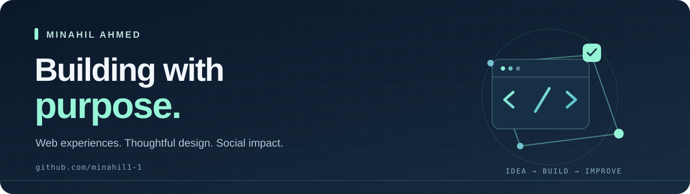
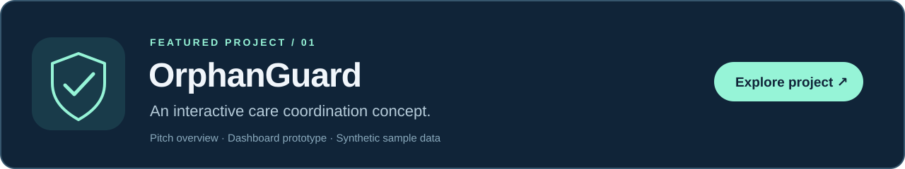

  

  <b>Web experiences · Thoughtful design · Social impact</b> 
  Turning meaningful ideas into clear, interactive experiences.

  <a href="https://github.com/minahil1-1/OrphanGuard-Interactive-Demo"><b>Explore OrphanGuard ↗</b></a>
  &nbsp; · &nbsp;
  <a href="https://github.com/minahil1-1?tab=repositories">Browse my work</a>

---

### Hi, I'm Minahil

I'm interested in building useful technology with a human purpose. My current work explores how interactive web interfaces can make care coordination and review workflows easier to understand.

- **Building:** OrphanGuard, an interactive pitch and dashboard prototype.
- **Exploring:** accessible interfaces, thoughtful product design, and technology for social good.
- **My approach:** start with a meaningful problem, make the experience clear, and improve it through iteration.

### Featured project

**[OrphanGuard Interactive Demo](https://github.com/minahil1-1/OrphanGuard-Interactive-Demo)** brings a care coordination concept to life through a pitch overview and an interactive dashboard. It uses synthetic sample records and scripted review flows to communicate the idea.

`JavaScript` &nbsp; `HTML` &nbsp; `CSS` &nbsp; `Node.js` &nbsp; `Express` &nbsp; `WebSockets`

*Prototype status: illustrative, in-memory data; no connected AI model or operational care service.*

### What guides my work

| Purpose | Craft | Progress |
| :--- | :--- | :--- |
| Build around problems that matter. | Make interfaces clear and approachable. | Share the work, learn, and keep improving. |

---

<b>Thoughtful ideas. Useful experiences.</b> Follow along as I build and share new projects.

